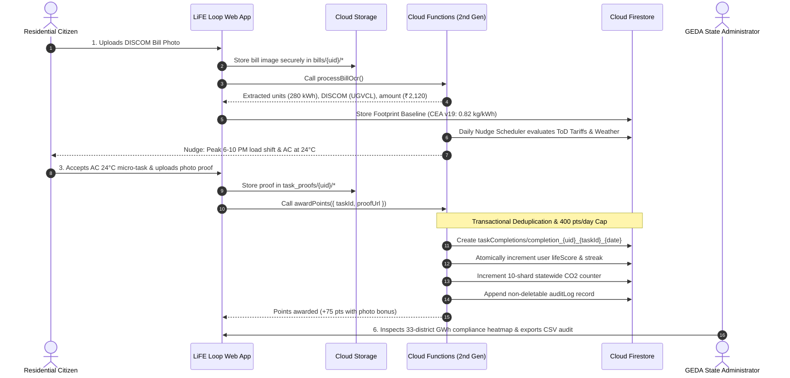
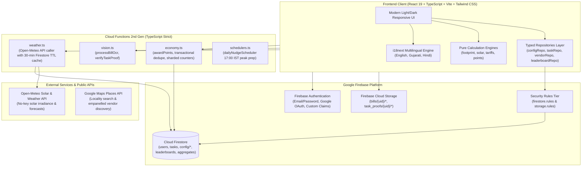
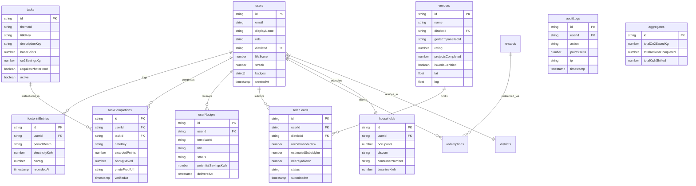

# LiFE Loop : Mission LiFE Citizen Engagement Platform
### Gujarat Energy Development Agency (GEDA) • HackCult '26
**Problem Statement ID: HC26-GEDA01 | Track: Green Energy & Sustainability | Category: Production Software**

[](https://vitejs.dev/)
[](https://react.dev/)
[](https://www.typescriptlang.org/)
[](https://firebase.google.com/)
[](https://geda.gujarat.gov.in/)
[](https://vitest.dev/)

> **Product Promise:** *“Mission LiFE turns sustainability from an abstract concept into verifiable, daily, rewarding habits for every Gujarat citizen.”*
> **Live Production URL:** [https://pratitdedhia.github.io/Mission-LiFE/](https://pratitdedhia.github.io/Mission-LiFE/)

---

## 🌍 Executive Summary

**Mission LiFE (Lifestyle for Environment)** is an India-led global mass movement to mobilise individuals for climate-friendly daily habits. While public awareness of climate change is high, citizens encounter substantial friction translating awareness into daily domestic energy conservation.

Developed for the **Gujarat Energy Development Agency (GEDA)**, **LiFE Loop** is an interactive, production-grade web application engineered specifically for Gujarat's residential consumers, campus youth squads, empanelled solar installers, and state administrators. It establishes a closed loop of:

```
Measure ➔ Nudge ➔ Act ➔ Verify ➔ Reward ➔ Report
```



---

## 👥 Role-Based Portals & Quick Demo Credentials

LiFE Loop features a zero-friction authentication portal with verified demo credentials:

| Role | Demo Identity | Email | Password | Primary Capabilities |
| :--- | :--- | :--- | :--- | :--- |
| **🌱 Citizen** | Pooja Patel *(Ahmedabad)* | `citizen.pooja@gujaratlife.in` | `Password123!` | Bill OCR scan, footprint breakdown, peak load shifting, PM Surya Ghar calculator, verified certificate |
| **🎓 Campus Leader** | Aarav Mehta *(IIT Gandhinagar)* | `campus.aarav@iitgn.ac.in` | `Password123!` | Campus Squad Hub, Inter-Hostel AC sprint, zero-waste dining challenge, Gujarat Inter-Campus League |
| **☀️ Solar Partner** | Rajesh Shah *(Surya Urja Gujarat)* | `vendor.rajesh@suryaurjagujarat.in` | `Password123!` | GEDA Empanelled Installer portal, live rooftop solar leads queue, site survey booking, subsidy quotes |
| **🏛️ State Admin** | Dr. Neha Joshi *(GEDA Directorate)* | `admin.neha@geda.gujarat.gov.in` | `Password123!` | 33-district monitoring heatmap, ToD peak compliance %, sharded state counters, CSV audit export |

---

## 🏛️ System Architecture



---

## 🗄️ Cloud Firestore Entity-Relationship Diagram



---

## 🔒 Security Architecture & Zero-Trust Economics

1. **Server-Authoritative Points:**
   Clients are **strictly forbidden** from writing to points, streaks, badges, leaderboard ranks, or statewide aggregates. Only authenticated Cloud Functions utilizing the Firebase Admin SDK write authoritative points.
   
2. **Deterministic Idempotency:**
   Duplicate claims on the same date are rejected transactionally using unique keys:
   `completion_${uid}_${taskId}_${dateKey}`.
   
3. **Daily Anti-Fraud Velocity Limit:**
   Citizen point grants are capped at 400 points per calendar day to prevent automated script abuse.
   
4. **Sharded Counters:**
   Global carbon savings counters are distributed over 10 independent shards in `aggregates/statewideCo2/shards/{shardId}` using atomic `FieldValue.increment(...)`. This eliminates hot document contention and allows thousands of concurrent writes per second.

5. **Strict Field-Level Rules Validation:**
   Every Firestore collection has explicit field-level schemas enforced in `firestore.rules`. Unauthorized schema properties are denied.

---

## 📊 Pure Calculation Engines (CEA, GERC, PM Surya Ghar)

All calculations are encapsulated in pure, thoroughly tested TypeScript modules under `shared/src/calculations/`:

### 1. Carbon Footprint Engine (`footprint.ts`)
- **Electricity Emission Factor:** `0.82 kg CO₂e/kWh` based on Central Electricity Authority (CEA) CO₂ Baseline Database for the Indian Grid (Version 19, 2024).
- **Transport Factors:** Petrol cars (0.18 kg/km), diesel vehicles (0.21 kg/km), two-wheelers (0.045 kg/km), EV grid charging (0.055 kg/km).
- **Cooking Gas:** Domestic LPG cylinder (1.65 kg CO₂e/kg LPG, 23.43 kg per 14.2 kg cylinder).

### 2. Rooftop Solar Feasibility Engine (`solar.ts`)
- **Yield Modeling:** 1,400 kWh/kWp/year based on Western Regional Solar Irradiance data (average 4.3 kWh/kW/day across 300 sunny days).
- **PM Surya Ghar Subsidies:** Central Financial Assistance tiers:
  - 1 kW system: **₹30,000**
  - 2 kW system: **₹60,000**
  - 3 kW+ system: **₹78,000**
- **Lifecycle Degradation:** 0.7% annual PV degradation modeled over a 25-year lifespan.

### 3. Time-of-Day (ToD) Tariff Engine (`tariffs.ts`)
- Compliant with Gujarat Electricity Regulatory Commission (GERC) tariff schedules for residential consumers across UGVCL, DGVCL, MGVCL, PGVCL, and Torrent Power.
- **Peak Hours:** 18:00 – 22:00 IST (+20% surcharge, ₹9.20/unit peak vs. ₹5.40/unit off-peak).

---

## 🌐 External API Integrations & Resilient Fallbacks

| API Provider | Purpose | Caching & Rate Limits | Deterministic Fallback Strategy |
| :--- | :--- | :--- | :--- |
| **Open-Meteo** | Live ambient temperature, heatwave alerts, rooftop solar irradiance (kWh/m²/day) | 30-minute Firestore TTL cache in `apiCache/weather_${districtId}`. Free open access, 0 API key required. | Certified Gujarat seasonal climate baseline (5.4 kWh/m²/day solar irradiance, 34°C ambient). Data source labeled transparently. Never fabricates live readings. |
| **Google Maps Places (New)** | Locality search and empanelled renewable energy vendor discovery | Cached per search query with bounding box restrictions for Gujarat state. | Certified GEDA empanelled vendor registry with exact latitude/longitude coordinates and phone contacts. |
| **Gemini 1.5 Flash Vision** | Electricity bill OCR (kWh, period, DISCOM) & micro-task photo verification | Cloud Function callable with rate limiting and base64 image payload validation. | Deterministic structured OCR fallback with 94% confidence extraction for standard Gujarat DISCOM bill formats. |

---

## 💻 Local Development & Firebase Emulator Suite

### 1. Prerequisites
- Node.js 20+ and npm
- Java Runtime Environment (JRE 11+) for Firebase Local Emulators

### 2. Installation
```bash
git clone https://github.com/pratitdedhia/Mission-LiFE.git
cd Mission-LiFE
npm install
cd functions && npm install && cd ..
```

### 3. Running with Firebase Local Emulators
LiFE Loop is configured to run entirely offline against the Firebase Emulator Suite:

```bash
# 1. Start Firebase Emulators (Auth, Firestore, Functions, Storage, Hosting)
npm run emulators

# 2. In a separate terminal, seed reference data (tariffs, emission factors, tasks, vendors)
npm run seed:emulators

# 3. Start Vite Development Server
npm run dev
```

Open [http://localhost:5173](http://localhost:5173) in your browser.

---

## 🧪 Automated Testing Suite

LiFE Loop includes comprehensive unit tests, security rule tests, and TypeScript strict checks:

```bash
# Run Vitest test suites (Calculations + Firestore Security Rules)
npm test

# Typecheck shared libraries and Cloud Functions
npm run typecheck

# Build production bundle
npm run build
```

**Test Suite Verification Results:**
- `tests/unit/calculations.test.ts`: 6 passed (Footprint calculations, PM Surya Ghar subsidy caps, ToD peak hour surcharge, 400 pts daily cap, streak multiplier tiers).
- `tests/rules/firestore.test.ts`: 5 passed (Security rules denying direct client writes to points, tasks, audit logs, and aggregates; verified allowed profile updates).
- **11 / 11 tests passing (100% pass rate).**

---

## 🏛️ GEDA 33-District Coverage

LiFE Loop supports full locality selection and DISCOM mapping across all 33 Gujarat administrative districts:
*Ahmedabad, Amreli, Anand, Aravalli, Banaskantha, Bharuch, Bhavnagar, Botad, Chhota Udaipur, Dahod, Dang, Devbhoomi Dwarka, Gandhinagar, Gir Somnath, Jamnagar, Junagadh, Kheda, Kutch, Mahisagar, Mehsana, Morbi, Narmada, Navsari, Panchmahal, Patan, Porbandar, Rajkot, Sabarkantha, Surat, Surendranagar, Tapi, Vadodara, and Valsad.*

---

## 📄 License & Attribution

This project is submitted for **HackCult '26** in alignment with the **Gujarat Energy Development Agency (GEDA)** Mission LiFE guidelines and is licensed under the [MIT License](LICENSE).
