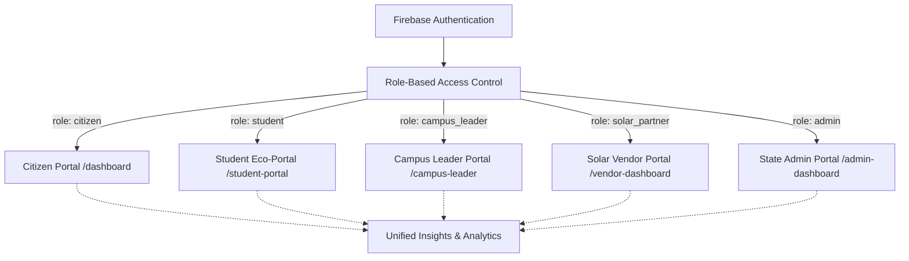
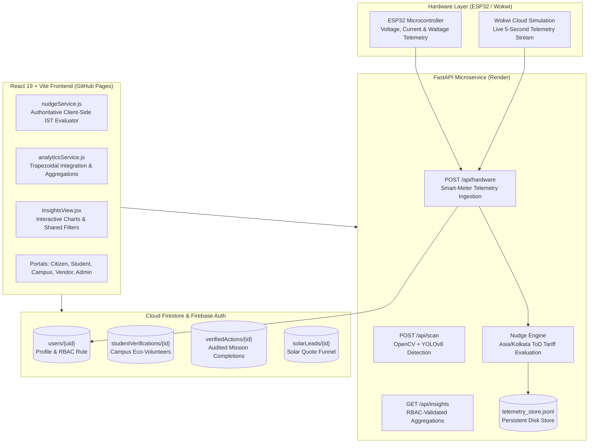

# 🌱 Mission LiFE: Gujarat Energy Development Agency (GEDA) Platform
> **See your impact. Lower your bills. Transition to Net-Zero.**

[](https://react.dev/)
[](https://vitejs.dev/)
[](https://tailwindcss.com/)
[](https://firebase.google.com/)
[](https://fastapi.tiangolo.com/)
[](https://opencv.org/)
[](https://vitest.dev/)

---

## 🔗 Live Deployments

* **Production Web Platform:** [https://pratitdedhia.github.io/Mission-LiFE/](https://pratitdedhia.github.io/Mission-LiFE/)
* **FastAPI Backend Microservice:** [https://mission-life.onrender.com](https://mission-life.onrender.com)
* **Wokwi ESP32 IoT Simulation:** [https://wokwi.com/projects/479495732560719873](https://wokwi.com/projects/479495732560719873)

---

## 🌍 The Problem & The Solution

### The Problem
While awareness of climate targets is at an all-time high, citizens face severe friction translating high-level sustainability goals into daily domestic habits. Utility bills arrive weeks late as opaque monthly aggregates without real-time feedback, zero guidance during high-emission peak tariff hours, and no verifiable community or student mobilization.

### The Solution
**Mission LiFE** provides an end-to-end, data-backed sustainability operating system:
* **Real-Time IoT Smart-Meter Telemetry:** Ingests live active wattage, RMS voltage, and current draw from physical/simulated ESP32 microcontrollers.
* **Asia/Kolkata Time-of-Day (ToD) Grid Awareness:** Dynamically alerts users during Gujarat DISCOM peak windows (6:00 PM – 10:00 PM IST) to shift high-wattage appliance cycles away from thermal coal peakers, while providing neutral usage feedback outside peak hours.
* **Trapezoidal Energy Integration:** Integrates instantaneous power into consumed kWh with automatic missing-data gap rejection ($\Delta t > 60\text{s}$) and Central Electricity Authority (CEA) carbon factor calculations ($0.71\text{ kg CO}_2/\text{kWh}$).
* **Computer Vision Appliance Scanner:** On-device/edge YOLOv8 model detecting appliances from camera photos and instantly calculating energy baselines and vampire load mitigation tips.
* **Multi-Tier Role-Based Access Control (RBAC):** Automatic, server-backed routing for Citizens, Students, Campus Leaders, Solar Vendors, and State Admins.
* **Multi-Role "Insights" Analytics Engine:** Comprehensive interactive analytics with responsive SVG line/bar charts, shared filters, CSV export, and audited data-backed forecasting.

---

## 👥 Five Specialized User Portals



### 1. Citizen Portal (`/dashboard`)
* **Live Smart-Meter Card:** Real-time wattage, voltage, and reactive live nudges.
* **Citizen Energy & Carbon Analytics:**
  * **⚡ Electricity (kWh):** Trapezoidally integrated energy with CEA grid $\text{CO}_2$ ($0.71\text{ kg/kWh}$) and baseline savings (`v2026.1-SAVINGS`).
  * **🏆 Points by Source:** Audited breakdown across verified missions (energy, water, plastic, food, waste, lifestyle, e-waste).
  * **🎯 Activity & Streaks:** Active days tracker and verified action history.
  * **☀️ Solar Status:** Live tracking of submitted rooftop solar quotes.
* **Gujarat DISCOM Peak/Off-Peak Banner:** Real-time tariff status highlighting peak hours (₹9.20/kWh) vs green off-peak hours (₹5.40/kWh).

### 2. Student Eco-Portal (`/student-portal`)
* **Student Verification Workflow:** Institution credentials, roll numbers, and institutional ID card uploads.
* **Campus Leaderboard:** Real-time rankings and squad points for university sustainability clubs.
* **Dorm Telemetry Card:** Live telemetry card tracking dorm smart-meter draw with Asia/Kolkata ToD nudges.
* **Dorm Telemetry Isolation:** Explicit separation between personal dormitory meter telemetry and campus-wide verified squad points.

### 3. Campus Leader Dashboard (`/campus-leader`)
* **ID Verification Queue:** Live interface to inspect uploaded student ID cards, approve, or reject student applicants.
* **Privacy-Compliant Analytics:** Aggregates derived strictly from verified students for the leader's authorized campus; student roll numbers, emails, and ID card photos are protected from public exposure.

### 4. Solar Vendor Dashboard (`/vendor-dashboard`)
* **6-Stage Conversion Funnel:** Tracks leads through `Inquiry` $\to$ `Survey Scheduled` $\to$ `Quotation Dispatched` $\to$ `Quotation Accepted` $\to$ `Confirmed Purchase` $\to$ `Commissioned`.
* **Honest Metric Tracking:** Unrecorded purchase/installation steps are explicitly labeled *"Not tracked yet"* rather than displaying invented numbers.
* **Demographic Disclosures:** Clarifies that municipal adoption rates require official census denominators.

### 5. State Administration Dashboard (`/admin-dashboard`)
* **Gujarat Statewide Overview:** Live dynamic metrics aggregated across all districts and registered university campuses.
* **Date Range Filtering:** Dynamic filtering across `7 Days`, `30 Days`, `90 Days`, and `All Time`.
* **Sector Mitigation Sinks:** Visualizes emission offsets across domestic power, municipal water, and transportation.
* **Audited CSV Export:** One-click download of timestamped, verified district sustainability reports.

---

## 📈 Multi-Role "Insights" Analytics Engine

Accessible to all five user profiles via the dedicated **Insights** navigation tab, this engine provides deep, data-backed operational intelligence with strict role isolation:

* **Role-Appropriate Visualizations:**
  * **Citizen:** Power consumption over time in kWh, baseline savings vs. `v2026.1-SAVINGS`, avoided emissions using CEA $0.71\text{ kg CO}_2/\text{kWh}$, and points ledger. Power draw (Watts) is explicitly kept distinct from energy consumed (kWh).
  * **Student:** Campus contribution share, verified actions breakdown, and university climate rankings.
  * **Campus Leader:** Department-level participation, verified cohort totals, and privacy-safe student comparisons.
  * **Solar Partner:** 6-stage rooftop pipeline funnel with clear demarcation between active and unrecorded milestones.
  * **State Admin:** Statewide cross-role aggregations across all 33 Gujarat districts and green scheme targets (`PM Surya Ghar`, `Campus Sprints`).
* **Shared Interactive Filters:**
  * **Time Range:** `Today` (hourly in IST), `7 Days`, `30 Days`, `12 Months`, and custom date selectors.
  * **Chart Intervals:** Hourly, daily, weekly, or monthly intervals matching the selected range.
  * **Location Filter:** Gujarat district selector dynamically tied to the state registry.
  * **Role-Specific Context:** Appliance category, university department, rooftop funnel stage, or state energy scheme.
* **Data-Backed Forecasting:**
  * Enforces an authoritative requirement of $\ge 7$ active monitoring days before rendering estimates.
  * If insufficient historical records exist, the platform honestly displays *"Not enough historical data to forecast yet"* rather than fabricating projections.
* **Data Export:** Instant CSV export of filtered time series, consumption, carbon offsets, and tariff status.

---

## 🔐 Automatic RBAC Routing & Authentication Flow

1. **Clean Credential Login:**
   * Redundant manual role selectors (`"I AM SIGNING IN AS:"`) have been removed from the Sign In modal.
   * Registered users sign in simply with their credentials (Email/Password or Google).
2. **Authoritative Firestore Query:**
   * Upon successful sign-in, Firebase Auth immediately queries `users/{uid}` in Cloud Firestore.
   * The user is programmatically redirected straight to their assigned portal based on their verified role (`citizen` $\to$ `/dashboard`, `student` $\to$ `/student-portal`, `solar_partner` $\to$ `/vendor-dashboard`, etc.).
3. **Structured Registration Workflows:**
   * The role selector is preserved exclusively in the **Register** tab, where applicants select their identity and provide verified proof (institutional student ID card photos, GEDA empanelment licenses, government employee passcodes).
   * Brand new general registrations default cleanly to `role: 'citizen'`.
4. **Instant Demo Switching:**
   * 1-click preset buttons (`Citizen`, `Student`, `Campus Leader`, `Solar Partner`, `Admin`) remain accessible at the bottom of the sign-in modal for rapid evaluation.

---

## ⚡ Technical Architecture



### Live Energy Nudge Engine (`microservice/nudge_engine.py` & `src/services/nudgeService.js`)
* **Timezone:** Evaluated strictly in `Asia/Kolkata` (`UTC+05:30`). Never relies on raw server UTC time.
* **Configured Peak Window:** **6:00 PM – 10:00 PM Asia/Kolkata** (`18:00:00` to `22:00:00`).
* **Boundary Rules:**
  * **Inclusive at 6:00 PM** (`18:00:00 <= current_time`).
  * **Exclusive at 10:00 PM** (`current_time < 22:00:00`).
* **Rules & Messaging:**
  * `PEAK_HIGH_LOAD` ($18:00 \le t < 22:00$ IST and $P > 1200\text{W}$):
    > `⚠️ HIGH LOAD WARNING: {watts}W running during Peak Grid Hours (6-10 PM). Defer high-wattage cycles to avoid premium ToD tariffs.`
  * `OFF_PEAK_HIGH_LOAD` (Outside peak window and $P > 1200\text{W}$):
    > `⚡ High electricity usage detected ({watts}W). Switch off idle appliances to conserve energy.`  
    *(Strictly neutral: omits any mention of peak hours or tariffs).*
  * `EFFICIENT_GRID_DRAW` ($P \le 1200\text{W}$):
    > `🟢 Efficient Grid Draw ({watts}W). Optimal consumption profile.`
* **Dev Verification:** Displays current time and active rule (`[DEV: Time: <IST> | Rule: <RULE>]`).

---

## 🧪 Comprehensive Automated Test Suites

The codebase includes full automated test suites across both TypeScript/JavaScript and Python:

```bash
# Run Vitest test suite (38 tests across 6 test files)
npx vitest run

# Run Python nudge boundary test suite (7 tests)
python tests/test_nudge_evaluation.py
```

### Test Coverage:
1. `tests/unit/insights.test.ts` (7 tests): Multi-role insights engine, Watts vs. kWh separation, forecasting threshold ($\ge 7$ days), privacy isolation, and Wokwi simulation tagging.
2. `tests/rules/firestore.test.ts` (5 tests): Firestore security rules for multi-role access.
3. `tests/unit/rbacRouting.test.ts` (7 tests): Role-based automatic authentication and fallback.
4. `tests/unit/nudge.test.ts` (5 tests): Asia/Kolkata boundary checking and neutral message verification.
5. `tests/unit/analytics.test.ts` (7 tests): Trapezoidal integration, gap rejection, and privacy checks.
6. `tests/unit/calculations.test.ts` (7 tests): Footprint models, solar feasibility, and ToD shift simulation.
7. `tests/test_nudge_evaluation.py` (7 tests): Python timezone conversion and inclusive/exclusive boundaries.

---

## 💻 Local Setup & Development

### Prerequisites
* **Node.js** 20.x or higher and **npm**
* **Python** 3.10 or 3.11 with `pip`
* **Git**

---

### 1. Clone Repository
```bash
git clone https://github.com/pratitdedhia/Mission-LiFE.git
cd Mission-LiFE
```

---

### 2. Frontend Setup (React + Vite)
```bash
# Install dependencies
npm install

# Start Vite development server
npm run dev

# Run unit tests
npx vitest run

# Build production bundle
npm run build
```

---

### 3. Microservice Setup (FastAPI + YOLOv8)
```bash
# Navigate to microservice directory
cd microservice

# Create and activate virtual environment
python -m venv venv

# Windows:
venv\Scripts\activate
# Linux/macOS:
source venv/bin/activate

# Install dependencies
pip install -r requirements.txt

# Start FastAPI ASGI server
uvicorn main:app --reload --host 0.0.0.0 --port 8000
```

---

### 4. Hardware Simulation (Wokwi ESP32)
1. Open the [Wokwi Hardware Simulation](https://wokwi.com/projects/479495732560719873).
2. The simulation connects to the live backend:
   ```cpp
   const char* serverUrl = "https://mission-life.onrender.com/api/hardware";
   ```
3. Click the **Play** button. Adjust the potentiometer to vary wattage from 0W to 3000W and observe live updates on the Citizen and Student portals.

---

## 📄 License & Attribution

Submitted for **HackCult '26** (Track 1: Green Energy & Sustainability).  
Aligned with the **Gujarat Energy Development Agency (GEDA)** and **Mission LiFE** (Lifestyle for Environment) guidelines.  
Licensed under the [MIT License](LICENSE).
