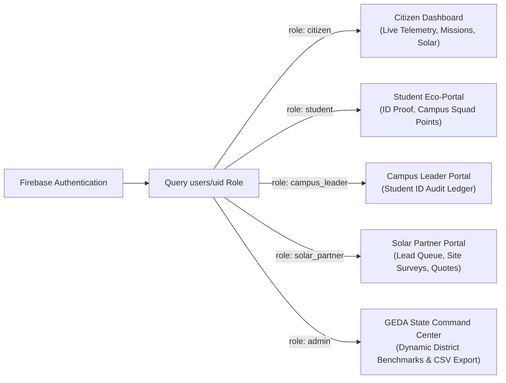
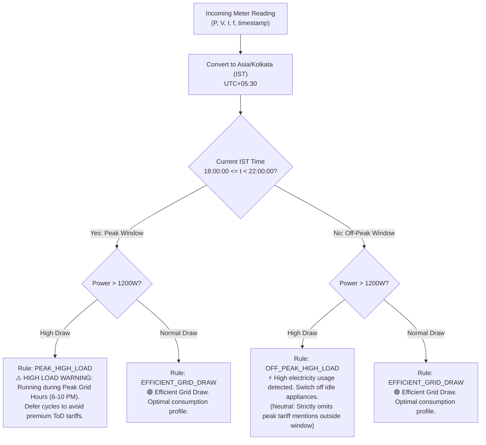

# 🌱 Mission LiFE (LiFE Loop)
> **Empowering Gujarat's Citizens, Campuses, and Contractors in the Transition to Net-Zero.**  
> *Developed for HackCult '26 (Track 1) • Problem Statement HC26-GEDA01: Interactive Mission LiFE Citizen Engagement Application*

[](https://react.dev/)
[](https://vitejs.dev/)
[](https://tailwindcss.com/)
[](https://firebase.google.com/)
[](https://fastapi.tiangolo.com/)
[](https://opencv.org/)
[](https://vitest.dev/)
[](https://pytest.org/)
[](https://opensource.org/licenses/MIT)

---

## 1. Title & Hackathon Problem Statement

* **Hackathon:** HackCult '26
* **Track:** Track 1 (State Energy & Climate Innovations)
* **Problem Statement HC26-GEDA01:** *Interactive Mission LiFE Citizen Engagement Application*
* **Target Agency:** Gujarat Energy Development Agency (GEDA), Government of Gujarat

Mission LiFE (Lifestyle for Environment) introduces an institutional, data-driven citizen engagement platform. It bridges the gap between high climate awareness and daily household action by combining real-time smart meter telemetry (ESP32/Wokwi), Time-of-Day (ToD) tariff grid nudges, computer vision appliance wattage scanning (YOLOv8), collegiate sustainability leagues, and PM Surya Ghar rooftop solar feasibility modeling.

---

## 2. Live Deployments & Demo Presets

* **Production Web Application (GitHub Pages):** [https://pratitdedhia.github.io/Mission-LiFE/](https://pratitdedhia.github.io/Mission-LiFE/)
* **Backend Microservice (Render):** [https://mission-life.onrender.com](https://mission-life.onrender.com)
  * Root Endpoint: `GET /` &nbsp;→&nbsp; `{"service": "mission-life-microservice", "version": "1.0.0", "status": "healthy"}`
  * Health Endpoint: `GET /health` &nbsp;→&nbsp; reports uptime, firestore connectivity, and device allow-list count.
* **Wokwi Live ESP32 Circuit Simulation:** [https://wokwi.com/projects/479495732560719873](https://wokwi.com/projects/479495732560719873)

### One-Click Demo Profiles (Navbar / Auth Modal Preset Switcher)
To facilitate thorough evaluation without tedious registration, 5 pre-configured Gujarat stakeholder profiles can be activated with a single click (secured via authoritative Firebase Auth and verified Firestore roles):

| Role Profile | Persona & Identity | District / Institution | Key Testing Capabilities |
| :--- | :--- | :--- | :--- |
| **Citizen** | Pooja Patel (`usr_citizen_pooja`) | Ahmedabad (UGVCL) | Live Wokwi potentiometer telemetry, peak ToD nudges, appliance inventory, and solar feasibility. |
| **Student** | Priyan Patel (`usr_student_priyan`) | IIT Gandhinagar | ID verification proof submission, collegiate habit points, and squad contributions. |
| **Campus Leader** | Aarav Mehta (`usr_campus_aarav`) | IIT Gandhinagar Eco Squad | ID card audit approval queue, privacy-safe departmental metrics, and inter-collegiate rankings. |
| **Solar Partner** | Rajesh Shah (`usr_vendor_rajesh`) | Surya Urja Solutions Gujarat | 6-stage PM Surya Ghar pipeline, quote generation, and two-way citizen chat liaison. |
| **State Admin** | Dr. Neha Joshi (`usr_admin_neha`) | Directorate of Energy Conservation | Statewide cross-role aggregations, 33-district energy heatmap, and audited CSV data export. |

---

## 3. Executive Summary & GEDA Problem Fit

Gujarat is India's clean energy leader, yet residential evening peak grid demand strains transmission infrastructure between **18:00 and 22:00 IST**. This forces state utilities (UGVCL, DGVCL, MGVCL, PGVCL, and Torrent Power) to fire expensive thermal peaking stations.

| Gujarat Specific Challenge | How Mission LiFE Solves It |
| :--- | :--- |
| **Opaque Monthly Utility Bills** | Real-time smart-meter telemetry ingests active wattage and calculates instant hourly costs under GERC residential tariff slabs. |
| **Peak Grid Stress (6–10 PM IST)** | Nudge engine strictly evaluates timestamps in `Asia/Kolkata` time, dispatching targeted alerts to shift dishwashers, washing machines, and pumps to off-peak hours. |
| **Complex PM Surya Ghar Sizing** | Dynamic solar rooftop sizing engine models Central Financial Assistance (up to ₹78,000 CFA), 25-year returns, and connects households with GEDA empanelled installers. |
| **Fragmented Youth Participation** | Institutional student verification portal where university eco-squads compete in verifiable energy reduction sprints. |
| **Audit Credibility for State Reporting** | Virtual/simulated Wokwi meter data is strictly tagged with `is_simulated: true` so state administrative audits can isolate empirical data from test readings. |

---

## 4. Architecture Diagram & System Flow

```mermaid
flowchart TD
    subgraph IoTLayer["Hardware Layer (ESP32 / Wokwi)"]
        ESP32["ESP32 DevKit v1\n(PZEM-004T / CT Sensor)"]
        Wokwi["Wokwi Cloud Simulation\n(Potentiometer Pin 34 ADC)"]
    end

    subgraph Microservice["FastAPI Microservice (Render)"]
        AllowListCheck["Device Registry Check\n(devices/{deviceId})"]
        RateLimit["Token Bucket Rate Limiter\n(~1 req / 2s per device)"]
        KeyAuth["X-Device-Key Constant-Time Check\n(Physical required, Wokwi demo bypassed)"]
        NudgeEngine["Nudge Evaluation Engine\n(Asia/Kolkata 18:00-22:00 IST)"]
        YoloScanner["YOLOv8 Vision Scanner\n(Lazy Loaded yolov8n.pt, 5MB limit, Magic Bytes)"]
        ConfigCache[("In-Memory 5-Minute Cache\nconfig/{tariffs, emissionFactors, nudgeRules}")]
        DiskBuffer[("telemetry_store.jsonl\nThread-Safe Persistent Disk Store")]
    end

    subgraph FirebaseBaaS["Cloud Firestore & Firebase Storage"]
        UsersCol[("users/{uid}\nProfile & Server-Derived Role")]
        VerifCol[("studentVerifications/{id}\nCampus Student Ledger")]
        ActionsCol[("verifiedActions/{uid}_{task}_{date}\nDeterministic IDs & Transactional Updates")]
        LeadsCol[("solarLeads/{id}\nPM Surya Ghar Lead Funnel")]
        ConfigCol[("config/*\nRegulatory Reference Collections")]
        StorageBuckets[("Storage Buckets\n/bills, /task_proofs, /student_ids")]
    end

    subgraph FrontendApp["React 19 + Vite Frontend (GitHub Pages)"]
        ErrorBoundary["ErrorBoundary.jsx\nUI Crash Resilience"]
        SuspenseRouter["React.lazy + Suspense\nRoute-Level Code Splitting"]
        ConfigService["configService.js + catalogService.js\nDynamic Zod Schemas & LocalStorage Cache"]
        ApiClient["apiClient.js\nToken Injection, Timeout & Cold-Start Resilience"]
        Portals["5 Specialized Portals\n(Citizen, Student, Campus, Vendor, Admin)"]
        InsightsEngine["Unified Multi-Role Insights Engine\n(Watts vs kWh Distinction & Granularity Controls)"]
        CsvUtil["csv.js\nRFC 4180 Quoting & Formula Injection Defense"]
    end

    ESP32 -->|HTTP POST JSON + X-Device-Key| AllowListCheck
    Wokwi -->|HTTP POST JSON (appliance_ac_01)| AllowListCheck
    AllowListCheck --> RateLimit
    RateLimit --> KeyAuth
    KeyAuth --> NudgeEngine
    NudgeEngine --> DiskBuffer
    ConfigCol -->|5-min Cache Sync| ConfigCache
    NudgeEngine --> ConfigCache
    KeyAuth -->|Admin SDK Write| UsersCol
    FrontendApp --> FirebaseBaaS
    FrontendApp --> Microservice
```

---

## 5. Zero-Hardcoding Contract

The repository enforces a strict **Zero-Hardcoding Contract**. No business parameters, carbon emission factors, electricity tariffs, government subsidy tiers, or mock user credentials are hardcoded into the client or microservice code:

1. **23 Comprehensive Seed Files (`/seed/`):**
   - Config Documents: `config.emissionFactors.json`, `config.tariffs.json`, `config.subsidyRules.json`, `config.solarModel.json`, `config.scoring.json`, `config.nudgeRules.json`, `config.forecast.json`.
   - Catalogs & Reference Data: `themes.json`, `tasks.json`, `badges.json`, `rewards.json`, `districts.json`, `campuses.json`, `departments.json`, `schemes.json`, `applianceCatalog.json`, `coachKnowledge.json`, `communityGoals.json`, `vendors.json`, `registry.json`, `campusSprints.json`, `devices.json`, `demoProfiles.json`.
2. **Client Dynamic Loaders (`src/services/configService.js` & `catalogService.js`):**
   - Zod runtime schema validation for all incoming configuration documents.
   - Offline read-through cache tagged with `_cachedAt` in `localStorage`.
   - Actionable fallback error if Firestore is uninitialized: `"Configuration missing: run npm run seed"`.
3. **Backend Microservice In-Memory Cache:**
   - 5-minute in-memory cache for `config/tariffs`, `config/nudgeRules`, and `config/emissionFactors`.
   - Reads directly from Firestore via Firebase Admin SDK with automatic fallback to local seed JSON.
4. **Automated CI Guards:**
   - `tests/unit/noHardcodedData.test.ts` (Vitest): Fails if banned tokens (`INITIAL_`, `DEMO_USERS`, `Password123`, `SEED_`) or business numeric literals appear outside config loaders.
   - `tests/test_backend_hardcoding.py` (Pytest): Scans backend Python scripts and Arduino sketches for banned tokens and validates required interfaces.

---

## 6. Five User Profiles & Role-Based Access Control (RBAC)

The platform provides dedicated, role-authorized dashboards for five key stakeholder identities:



1. **Residential Citizen (`/dashboard`):** Real-time smart-meter telemetry, ToD peak warnings, dynamic appliance baseline calibration, and PM Surya Ghar solar sizing.
2. **Student Volunteer (`/student-portal`):** Institutional enrollment verification, department credentials, and collegiate eco-squad competition.
3. **Campus Youth Leader (`/campus-leader`):** Student ID audit approval queue, privacy-conscious departmental analytics, and collegiate sustainability metrics.
4. **Empanelled Solar Partner (`/vendor-dashboard`):** 6-stage PM Surya Ghar rooftop lead pipeline, quotation generation, and two-way citizen messaging.
5. **GEDA State Administrator (`/admin-dashboard`):** Statewide cross-role aggregations across Gujarat districts, peak ToD load-shifting compliance, and audited CSV data export.

---

## 7. Real-Time Hardware IoT Telemetry Bridge (ESP32 / Wokwi)

The hardware telemetry bridge connects physical or simulated microcontrollers to the microservice:

* **Hardware Target:** ESP32 DevKit v1 with PZEM-004T (Modbus UART) or ACS712 / ZMPT101B ADC current/voltage sensors.
* **Wokwi Cloud Simulation:** Uses a 10kΩ potentiometer connected to GPIO34 (ADC1) to simulate dynamic household loads (0W to 3500W).
* **Device Registry Check:** Every incoming telemetry request validates `payload.device_id` against registered Firestore `devices/{deviceId}` (or `seed/devices.json`). Malicious or unformatted IDs are rejected with HTTP 422; unregistered devices are rejected with HTTP 404.
* **Token Bucket Rate Limiting:** Telemetry is capped at **~1 request per 2 seconds** per device (0.5 tokens/s, burst capacity 2.0). Excessive bursts are rejected with HTTP 429.
* **Authentication:** Physical IoT microcontrollers require an `X-Device-Key` header with constant-time verification (`hmac.compare_digest`). The simulated Wokwi demo device (`appliance_ac_01`) is flagged with `simulated: true` and permitted without a key.
* **Simulated Data Tagging:** All Wokwi readings carry `is_simulated: true` and `source_type: "wokwi_simulated"` derived directly from the server-side device registry, guaranteeing that clients cannot forge empirical status.
* **Resilient Polling & Backoff:** Client-side telemetry polling runs at 6s nominal intervals, automatically pauses when the browser tab is hidden (`document.visibilityState === 'hidden'`), and applies exponential backoff up to 30s during network anomalies.

---

## 8. Nudge Evaluation Engine (Time-of-Day Grid Awareness)

The nudge evaluation engine aligns household energy use with Gujarat's Time-of-Day grid dynamics:



* **Timezone Specification:** Evaluated strictly in `Asia/Kolkata` (`UTC+05:30`). Never relies on server UTC hour.
* **Boundary Definition:** Inclusive start at `18:00:00` IST; exclusive end at `22:00:00` IST.
* **Neutral Off-Peak Messaging:** Outside the peak window, high wattage triggers a neutral alert (*"High electricity usage detected"*) without referencing peak tariffs.
* **Dynamic Configuration:** Threshold wattage and peak hours are loaded dynamically from Firestore `config/nudgeRules`.

---

## 9. AI & Machine Learning Appliance Scanner

Located in `src/components/ApplianceScanner.jsx` and powered by `/api/scan` in `microservice/main.py`:

* **Computer Vision Model:** YOLOv8 nano (`yolov8n.pt`) with OpenCV image preprocessing.
* **Defensive Upload Gate:** Rejects files exceeding 5 MB (HTTP 413) and verifies magic bytes for JPEG, PNG, and WebP formats (HTTP 415). Input images are scaled to max 1280px to protect memory.
* **Lazy Loading:** Weights load into system memory only on the first `/api/scan` request to keep idle RAM usage minimal. Returns HTTP 503 if weights are unavailable.
* **Appliance Specifications:** Mapped dynamically from `applianceCatalog` reference collection.
* **COCO Dataset Reality:** Pre-trained COCO weights detect: `refrigerator`, `microwave`, `oven`, `tv`, and `laptop`. Heavy domestic cooling/heating loads (`air conditioner`, `ceiling fan`, `geyser`) are not present in standard COCO.
* **Honest Fallback Contract:** When an uncatalogued appliance is scanned, the API returns `detection: "none"`, and the user interface offers a manual selection picker rather than fabricating synthetic detections.

---

## 10. PM Surya Ghar Solar Rooftop Advisory & Subsidy Engine

Implemented in `src/components/SolarAdvisor.jsx` and `shared/src/calculations/solar.ts`:

* **Feasibility Calculation:** Determines optimal PV capacity based on monthly consumption and Gujarat solar insolation:
  $$\text{Capacity (kW)} = \max\left(1.0, \, \min\left(10.0, \, \text{round}\left(\frac{\text{Monthly Units}}{30 \times 4.3\text{ kWh/kW/day}} \times 2\right) / 2\right)\right)$$
* **PM Surya Ghar Central Financial Assistance (CFA):**
  - **1 kW System:** ₹33,000 Central Subsidy
  - **2 kW System:** ₹66,000 Central Subsidy
  - **3 kW+ System:** ₹78,000 Central Subsidy (Capped maximum under MNRE Feb 2024 guidelines)
* **25-Year Yield Model:** Models 0.7%/year module degradation, GERC net-metering feed-in tariff, and annual bill offsets.
* **Empanelled Installer Funnel:** Generates official GEDA lead reference numbers (`GEDA-SOLAR-XXXXXX`) and dispatches quotes to verified contractors.

---

## 11. Unified Multi-Role Insights Engine

Accessible via the **Insights** tab for all five profiles, providing customized operational intelligence:

* **Strict Watt vs. kWh Separation:** Instantaneous power (Watts) is strictly separated from accumulated energy consumed (kWh) to maintain scientific rigor.
* **Standardized CEA Emission Factor:** Standardized to **$0.71\text{ kg CO}_2/\text{kWh}$** citing Central Electricity Authority Baseline Database v20.0 (December 2024).
* **Shared Interactive Filters:** Time range (Today, 7D, 30D, 12M, Custom), granularity (Hourly, Daily, Weekly, Monthly), and 33 Gujarat administrative districts.
* **Data-Backed Forecasting:** Requires $\ge 7$ active days of historical data before rendering projections. If data is insufficient, it displays a clear notice rather than fabricating numbers.
* **RFC 4180 CSV Data Export:** One-click download of filtered time series, consumption, and carbon metrics with leading-apostrophe formula injection defense and UTF-8 BOM.

---

## 12. Gamification, Badges & Carbon Economy

* **Anti-Fraud Transactional Engine (`src/services/gamificationEngine.js`):**
  - All mission claims execute inside an authoritative Firestore `runTransaction`.
  - Deterministic document ID `{uid}_{taskId}_{YYYY-MM-DD}` (Asia/Kolkata date key) prevents multiple daily claims even if browser cache or localStorage is cleared.
  - Unknown mission IDs are rejected with `UNKNOWN_MISSION` (zero default points).
  - Daily streaks increment at most once per IST calendar day and reset to 1 if a day was skipped.
  - Failed transactions return `{ success: false }` to the UI with user-friendly messages (never reports false success).
* **7 Mission LiFE Themes:** Energy Saving, Water Conservation, Single-Use Plastic Reduction, Sustainable Food Systems, Solid Waste Reduction, Healthy Lifestyles, and E-Waste Recycling.
* **Bounded Verification Writes:** Client submissions to `verifiedActions` enforce strict field-level validation:
  - `awardedPoints`: between 0 and 100 points per mission.
  - `co2KgSaved`: between 0 and 50 kg CO2.
  - Schema whitelist prevents unauthorized metadata tampering.
* **Milestone Badges:** Prakriti Mitra, Energy Saver, Solar Champion, Campus Squad Warrior.

---

## 13. Security, Rules & Integrity Hardening

* **Authentication & Authorization (`src/services/authService.js`):**
  - Zero unauthenticated fallback sessions; failed Firebase Auth returns `{ success: false }`.
  - Roles are authoritative from Firestore `users/{uid}`, never accepted from client `roleHint` parameters.
  - Signups default strictly to `role: 'citizen'`; privileged roles can only be granted by administrators.
* **Firestore Security Rules (`firestore.rules`):**
  - `getUserRole()` Fallback: Checks custom token claim `request.auth.token.role` first; falls back to `get(/databases/$(database)/documents/users/$(request.auth.uid)).data.role`.
  - Role Escalation Guard: Users cannot alter their own `role`, `points`, `streak`, `badges`, or `lifeScore`.
  - Reference Collection Locks: Client writes to `config/*`, `tasks`, `themes`, `badges`, `rewards`, `schemes`, and `applianceCatalog` are blocked.
  - Student Verification Integrity: Student can create `status: 'pending'`; approval is restricted to the campus leader of the same campus or admin.
* **Storage Rules (`storage.rules`):** Enforces 5 MB size limit and `image/(jpeg|png|webp)` or `application/pdf` MIME restrictions across `/bills`, `/task_proofs`, and `/student_ids`.
* **Spreadsheet Injection Defense (`src/utils/csv.js`):** Prepend `'` to cells starting with `=`, `+`, `-`, or `@` to prevent formula execution in Microsoft Excel and LibreOffice Calc.
* **Production Console Safety (`src/utils/logger.js`):** Suppresses sensitive profile, email, and telemetry logging in production builds.

---

## 14. Comprehensive Technical Stack

### Frontend Application
* **Framework:** React 19 (`19.0.0`) + Vite (`6.1.0`)
* **Styling:** Tailwind CSS v4 (`@tailwindcss/vite`)
* **Icons & Animation:** Lucide React (`0.475.0`), Canvas Confetti
* **BaaS SDK:** Firebase Web SDK v11 (`11.3.0` with `@grpc/grpc-js` v1.14.7 override)
* **Data Validation:** Zod v3/v4 (`zod`)
* **Internationalization:** i18next + react-i18next (English, Gujarati, Hindi)
* **Testing:** Vitest (`5.0.5`)

### Backend Microservice
* **Framework:** FastAPI (`0.110.0`) + Uvicorn (`0.28.0`)
* **Computer Vision:** Ultralytics YOLOv8 (`yolov8n.pt`), OpenCV (`opencv-python-headless`)
* **Data Validation:** Pydantic v2 (`pydantic==2.6.4`)
* **Admin SDK:** Firebase Admin SDK (`firebase-admin==6.5.0`)
* **Testing:** Pytest (`9.2.0`) + HTTPX TestClient

---

## 15. Verification, Testing & CI Guards

```powershell
# 1. Run Vitest test suite (80 passing tests across 10 suites)
cmd /c npx vitest run

# 2. Run Pytest backend test suite (11 passing tests across 3 suites)
python -m pytest

# 3. Verify zero-hardcoding CI guards specifically
cmd /c npm run check:hardcoding

# 4. Check dependencies for known vulnerabilities
cmd /c npm audit --omit=dev
python -m pip_audit --local

# 5. Verify production bundle build
cmd /c npx vite build
```

---

## 16. Local Setup & Windows Installation Guide

### Prerequisites
- Node.js $\ge 18.0.0$ and npm
- Python $\ge 3.10$ and pip
- Windows PowerShell

### Step 1: Clone Repository
```powershell
git clone https://github.com/pratitdedhia/Mission-LiFE.git
cd Mission-LiFE
```

### Step 2: Configure Environment Variables
```powershell
Copy-Item .env.example .env
```
Ensure your `.env` contains:
```env
VITE_ENABLE_DEMO_LOGIN=true
VITE_FIREBASE_PROJECT_ID=hackcult-f9a20
```

### Step 3: Install Frontend Dependencies & Run Dev Server
```powershell
cmd /c npm install
cmd /c npm run dev
```
Open `http://localhost:5173/Mission-LiFE/` in your browser.

### Step 4: Run FastAPI Microservice Locally
```powershell
cd microservice
python -m pip install -r requirements.txt
uvicorn main:app --reload --port 8000
```
Interactive OpenAPI documentation will be accessible at `http://localhost:8000/docs`.

---

## 17. Database Seeding Instructions

The database seeder (`scripts/seed.ts`) validates and seeds all 23 configuration documents and demo profiles:

```powershell
# Dry run to validate all 23 seed JSON files without connecting to Firestore
cmd /c npx tsx scripts/seed.ts --dry-run

# Seed to local Firebase Emulator
cmd /c npx tsx scripts/seed.ts --emulator

# Seed to live Firestore (requires GOOGLE_APPLICATION_CREDENTIALS)
$env:GOOGLE_APPLICATION_CREDENTIALS="C:\path\to\serviceAccountKey.json"
cmd /c npx tsx scripts/seed.ts

# Target specific collection
cmd /c npx tsx scripts/seed.ts --only config
```

---

## 18. Status & Limitations (Truth Over Marketing)

| Subsystem / Feature | Current Implementation Status | Architectural Reality |
| :--- | :---: | :--- |
| **Grid Factor Standardization** | ✅ Complete | Unified to $0.71\text{ kg CO}_2/\text{kWh}$ (CEA v20.0 Dec 2024) across frontend, microservice, and docs. |
| **Live ToD Nudges (Asia/Kolkata)** | ✅ Complete | Evaluated strictly in `Asia/Kolkata`. Inclusive at 18:00, exclusive at 22:00 IST. Neutral outside window. |
| **Zero-Hardcoding Architecture** | ✅ Complete | All 23 config/catalog files dynamic; guarded by Vitest and Pytest CI tests. |
| **Multi-Role Insights Engine** | ✅ Complete | All 5 profiles supported with responsive SVG charts, shared filters, and RFC 4180 CSV export. |
| **Hardware Telemetry Bridge** | ✅ Complete | ESP32 and Wokwi post to `/api/hardware` with token bucket rate limiting (~1 req / 2s), regex validation, and allow-list check. |
| **Appliance Vision Scanner** | ✅ Complete | Lazy-loaded YOLOv8 on FastAPI with 5 MB upload limit, magic byte validation, and honest fallback contract. |
| **Firestore Security Rules** | ✅ Complete | 16 rules tests passing; bounded point inflation prevention; `getUserRole()` fallback active. |
| **Automated Cloud Functions** | 📋 Source Only | Cloud Function code exists in `functions/src/economy.ts`; client enforces defensive field-level bounds on `verifiedActions`. |
| **Gemini Vision Bill OCR** | 📋 Roadmap | Energy baselines currently configured via interactive questionnaire and appliance inventory; direct OCR scheduled for Phase 2. |

### HackCult '26 Judging Criteria Mapping

| Judging Criterion | Weight | How Mission LiFE Satisfies It |
| :--- | :---: | :--- |
| **Technical Execution & Code Quality** | **40%** | Zero-hardcoding contract, React 19 + Tailwind v4, Pydantic validation, token bucket rate limiting, 80 Vitest tests, 11 Pytest tests, 0 audit vulnerabilities. |
| **Architecture & Scalability** | **30%** | Dynamic configuration caching (5-min TTL), two-tier RBAC rules, persistent disk buffer, Wokwi IoT bridge, lazy-loaded ML weights. |
| **UI/UX Excellence** | **20%** | 5 specialized stakeholder portals, responsive SVG insights charts, dark/light theme, multi-lingual (English, Gujarati, Hindi). |
| **Innovation & Problem Fit** | **10%** | Solves Gujarat's 6–10 PM peak load stress under GERC ToD regulations and streamlines PM Surya Ghar rooftop solar onboarding. |

---

## License

Developed for HackCult '26 (Track 1: GEDA HC26-GEDA01). Released under the [MIT License](file:///c:/Users/dedhi/Downloads/hackcult/LICENSE).
