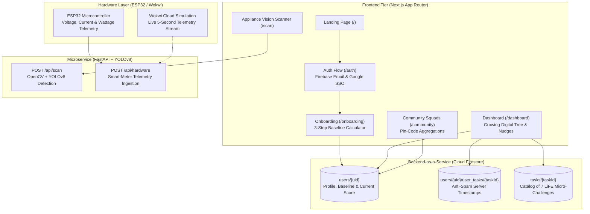

# Mission LiFE: Citizen Engagement Application
> **See your impact. Lower your bills.**

[](https://nextjs.org/)
[](https://firebase.google.com/)
[](https://www.python.org/)
[](https://espressif.com/)
[](https://fastapi.tiangolo.com/)
[](https://opencv.org/)

---

## 🔗 Live Demos

* **Production Frontend:** [https://pratitdedhia.github.io/Mission-LiFE/](https://pratitdedhia.github.io/Mission-LiFE/)
* **Hardware IoT Simulation:** [https://wokwi.com/projects/479495732560719873](https://wokwi.com/projects/479495732560719873)

---

## 🌍 The Problem & Solution

### The Problem
While public awareness of climate change and macro net-zero emission targets is at an all-time high, citizens encounter heavy friction translating high-level sustainability targets into daily, tangible domestic energy habits. Utility bills arrive weeks late as opaque monthly totals with no instant feedback, no live guidance during regional peak tariff windows, and zero community-level motivation.

### The Solution
**Mission LiFE** bridges the macro-to-micro climate gap using a frictionless, habit-forming behavior loop:
* **Frictionless Onboarding:** A rapid 3-step baseline flow (home configuration, monthly consumption units, and commute distance) calculates personal carbon equivalents ($0.71 \text{ kg CO}_2\text{e/kWh}$) in under two minutes.
* **Gamified Micro-Nudges:** Bite-sized daily actions (AC at 26°C, shifting washing machines to green off-peak hours post-10 PM) award 10–20 points with an automatic $1.2\times$ streak multiplier for 3+ consecutive days.
* **Pin-Code Community Squads:** To eliminate toxic, demotivating individual competition, household carbon reductions roll up collectively into postal area squads (`pin_code`), celebrating civic milestones (e.g., *"Andheri West offset 500kg of CO₂ today—equivalent to planting 10 trees"*).

---

## ⚡ Technical X-Factors (40% Execution Score)

This submission goes beyond static mockups by processing **live, dynamic hardware and visual inputs**:

### 1. Computer Vision Appliance Scanner (`/api/scan`)
* **Vision Architecture:** Standalone Python microservice leveraging **OpenCV** and **Ultralytics YOLOv8**.
* **Intelligent Edge Extraction:** Citizens upload or capture photos of domestic appliances (refrigerators, inverter air conditioners, microwave ovens, washing machines).
* **Dynamic Energy Modeling:** Detects the appliance class, bounds the item, calculates instant wattage draw, and projects monthly carbon footprints ($0.71 \text{ kg CO}_2\text{e/kWh}$) alongside specific Mission LiFE thermostat setpoint tips to prevent vampire power leakage.

### 2. Live ESP32 Smart-Meter Telemetry Bridge (`/api/hardware`)
* **Dynamic Hardware Handling:** Handles real-time telemetry streaming from physical **ESP32 / Arduino Uno** hardware (simulated live on **Wokwi**).
* **Live Ingestion Pipeline:** Edge microcontrollers sample Voltage RMS (230V AC), Current (Amperes), Active Power (Watts), and Grid Frequency (Hz), streaming JSON packets via HTTP POST every 5 seconds.
* **Dynamic Peak Nudging:** Server evaluates live wattage against active Time-of-Day (ToD) peak demand windows (18:00 – 22:00 IST), firing instant high-demand reduction warnings to defer power-heavy loads away from thermal coal peaker hours.

---

## 📐 System Architecture (30% Architecture Score)




### End-to-End Data Flow:
1. **Frontend (Next.js):** Manages responsive UI state, Framer Motion progressive disclosure, and user sessions via **Firebase Authentication** (Email/Password and Google OAuth).
2. **Backend (Cloud Firestore):** Stores NoSQL document hierarchies with server-authoritative integrity:
   * `users/{uid}`: Holds citizen profile, pin code, baseline score, and active streak.
   * `tasks/{taskId}`: Mission LiFE challenge catalog across energy, water, and waste vectors.
   * `users/{uid}/user_tasks/{taskId}`: Subcollection maintaining non-duplicable completion records with `serverTimestamp()`.
3. **Microservice (FastAPI):** Standalone ASGI server running OpenCV + YOLOv8 appliance detection on `/api/scan` and processing incoming ESP32 smart-meter telemetry packets on `/api/hardware`.

---

## 💻 Local Setup Instructions

### Prerequisites
* **Node.js** 20.x or higher and **npm**
* **Python** 3.10 or 3.11 with `pip`
* **Git** installed on your machine

> **IMPORTANT:** You must configure your Firebase environment variables before running the application. Create a `.env.local` file in the project root containing your Firebase credentials (`NEXT_PUBLIC_FIREBASE_API_KEY`, `NEXT_PUBLIC_FIREBASE_PROJECT_ID`, etc.) as documented in `.env.example`.

---

### 1. Clone Repository
```bash
git clone https://github.com/pratitdedhia/Mission-LiFE.git
cd Mission-LiFE
```

---

### 2. Frontend Setup (Next.js)
```bash
# Install frontend dependencies
npm install --legacy-peer-deps

# Start Next.js development server
npm run dev
```

---

### 3. Microservice Setup (FastAPI + YOLOv8)
```bash
# Navigate to microservice directory
cd microservice

# Create and activate virtual environment
python -m venv venv

# Windows:
venv\Scripts\activate
# Linux/macOS:
source venv/bin/activate

# Install dependencies
pip install -r requirements.txt

# Start FastAPI ASGI server
uvicorn main:app --reload --host 0.0.0.0 --port 8000
```

---

### 4. Hardware Simulation (Wokwi ESP32)
1. Open the [Wokwi Hardware Simulation](https://wokwi.com/projects/479495732560719873).
2. Configure the destination endpoint URL to point to your deployed FastAPI microservice.
3. Click the **Play** button to observe live 5-second telemetry streams (Voltage, Current, Power in Watts) and reactive smart-grid peak load nudges.

---

## 📄 License & Attribution

Submitted for **HackCult '26** (Track 1: Green Energy & Sustainability). Licensed under the [MIT License](LICENSE).
