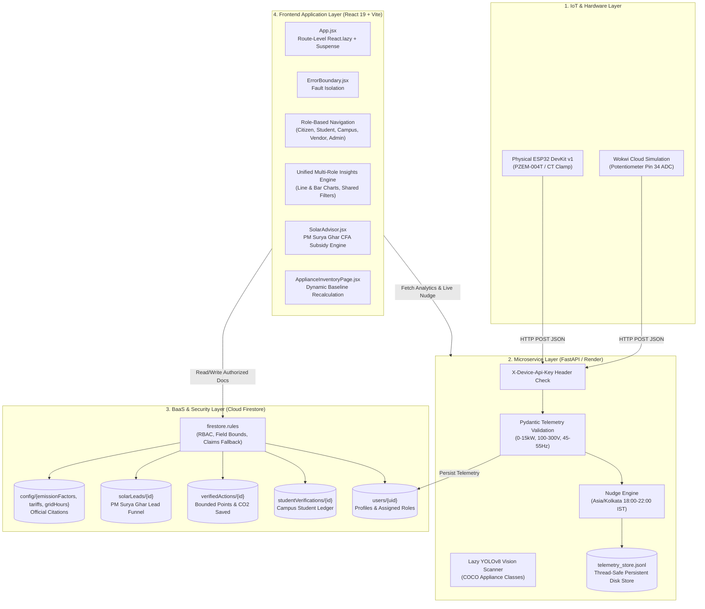

# Mission LiFE (LiFE Loop) — System Architecture

**HackCult '26 Track 1 Submission (HC26-GEDA01)**  
**Target Agency:** Gujarat Energy Development Agency (GEDA), Government of Gujarat  
**Product:** Mission LiFE | **Tagline:** LiFE Loop

---

## 1. High-Level Architecture Overview

Mission LiFE is engineered as a hybrid cloud-and-edge sustainability platform designed to ingest high-frequency IoT smart-meter readings, evaluate Time-of-Day (ToD) tariff economics, engage citizens and students across five specialized identities, and aggregate statewide carbon abatement metrics for the Gujarat Energy Development Agency.

---

## 2. Frontend Architecture (React 19 + Vite + Tailwind v4)

### 2.1 Route-Level Code Splitting & Chunk Strategy
To minimize initial bundle overhead on mobile devices and variable 4G networks across Gujarat, the application implements route-level lazy loading via `React.lazy()` and `Suspense`:
- **`Dashboard.jsx`** (~57 kB): Citizen overview, live smart-meter card, daily challenges, and footprint strip.
- **`StudentPortal.jsx`** (~26 kB): Institutional student enrollment, ID upload, and dorm telemetry.
- **`CampusLeaderDashboard.jsx`** (~29 kB): Campus audit ledger and student verification queues.
- **`SolarVendorDashboard.jsx`** (~63 kB): Empanelled contractor lead funnel and solar site surveys.
- **`AdminDashboard.jsx`** (~47 kB): 33-district administrative command center with CSV exports.
- **`InsightsView.jsx`** (~28 kB): Responsive SVG time-series charts, shared multi-tier filters, and forecasting.
- **`ApplianceInventoryPage.jsx`** (~22 kB): Household appliance registry with dynamic baseline overrides.

`vite.config.js` configures dedicated manual chunks:
- `firebase`: Bundles Firebase App, Auth, Firestore, and Storage.
- `i18n`: Bundles `i18next` and `react-i18next` for English, Gujarati, and Hindi translations.
- `vendor`: Bundles core UI libraries (`react`, `react-dom`, `lucide-react`, `canvas-confetti`).

### 2.2 Error Boundaries & Fault Isolation
The primary viewport in `src/App.jsx` is wrapped in an `ErrorBoundary` (`src/components/ErrorBoundary.jsx`). If a transient rendering failure occurs in a complex chart component or localized module, the error boundary traps the exception, prevents blank-screen unmounts, and provides an instant "Reload View" button.

---

## 3. Microservice Architecture (FastAPI + YOLOv8 + Telemetry Bridge)

The backend microservice is deployed at `https://mission-life.onrender.com` using FastAPI:

### 3.1 Telemetry Ingestion Pipeline (`POST /api/hardware`)
1. **Authentication:** Checks incoming request header `X-Device-Api-Key` against the server's `DEVICE_API_KEY`. Rejects unauthenticated devices with HTTP 401 when configured.
2. **Pydantic Validation (`HardwareTelemetry`):**
   - Active Wattage: $0 \le P \le 15,000\text{ W}$
   - Voltage: $100.0 \le V \le 300.0\text{ V}$
   - Current: $0.0 \le I \le 65.0\text{ A}$
   - Grid Frequency: $45.0 \le f \le 55.0\text{ Hz}$
3. **Asia/Kolkata Time-of-Day Evaluation:**
   - Evaluates timestamps using Python's `zoneinfo` / `ZoneInfo("Asia/Kolkata")`.
   - Inclusive start: `18:00:00` IST. Exclusive end: `22:00:00` IST.
   - During peak hours with $P > 1200\text{W}$, emits `PEAK_HIGH_LOAD` advising tariff deferral. Outside peak hours, emits neutral `OFF_PEAK_HIGH_LOAD` without false peak tariff claims.
4. **Thread-Safe Dual Storage:**
   - Primary: Writes directly to Firestore under `users/{uid}/telemetry` and `users/{uid}/appliances/{device_id}`.
   - Cache: Appends to `telemetry_store.jsonl` guarded by a Python `threading.Lock()` to prevent file corruption.

### 3.2 Vision Scanner Pipeline (`POST /api/scan`)
- **Lazy Loading (`get_yolo_model()`):** Model weights (`yolov8n.pt`) load into RAM only when the first scan is requested, avoiding cold-start memory spikes.
- **Supported COCO Classes:** Pre-trained weights recognize `refrigerator`, `microwave`, `oven`, `tv`, `laptop`.
- **Honest Detection Contract:** When an uncatalogued appliance is scanned, the microservice returns `{"detection": "none", "detected_appliances": []}`, triggering the client to present a manual selection catalog rather than injecting synthetic detections.

---

## 4. BaaS & Security Architecture (Cloud Firestore)

### 4.1 Role-Based Access Control (RBAC)
Security rules in `firestore.rules` protect sensitive collections:
- `getUserRole()`: Checks custom token claims first (`request.auth.token.role`), then falls back to `get(/databases/$(database)/documents/users/$(request.auth.uid)).data.role` for standard email/password and Google accounts.
- `studentVerifications`: Students can only create documents for themselves. Only users with role `campus_leader` or `admin` of the same campus can modify verification status.
- `verifiedActions`: Client writes are constrained to whitelisted keys, points are capped at $\le 100$, and $\text{CO}_2$ saved is capped at $\le 50\text{ kg}$ per action.
- `solarLeads`: Only the lead owner, empanelled solar partners (`solar_partner` / `solar_vendor`), and state admins have read/write access.

---

## 5. IoT & Hardware Simulation Layer (ESP32 + Wokwi)

### 5.1 Real Hardware vs. Wokwi Simulation
- **Physical Hardware:** ESP32 DevKit v1 interfacing with PZEM-004T (Modbus UART) or current transformer (CT clamp) on analog pin.
- **Wokwi Simulator:** ESP32 DevKit v1 with a 10k potentiometer on GPIO 34 (ADC1 Channel 6).
- **Potentiometer Calibration:** Maps raw 12-bit ADC ($0 - 4095$) linearly to active household load ($0 - 3000\text{ W}$).
- **Data Provenance Tagging:** All simulated packets carry `source_type: "wokwi_simulated"` and `is_simulated: true`, allowing analytics pipelines to filter out virtual readings from official municipal audits.

