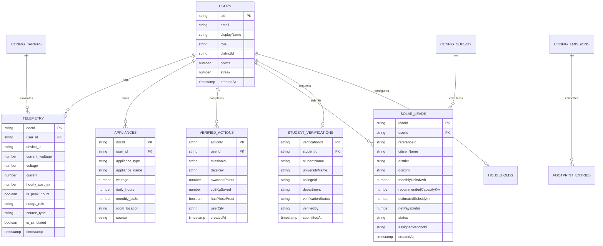

# Mission LiFE — Database Schema & Data Dictionary

**Database Engine:** Google Cloud Firestore (Document Database)  
**Security Enforcement:** `firestore.rules` (rules_version = 2)

---

## 1. Entity-Relationship Diagram

---

## 2. Core Collections & Field Dictionaries

### 2.1 Collection: `users`
Represents individual accounts across all 5 stakeholder roles.
- Document ID: `userId` (Firebase Auth UID).
- Read: Authenticated users.
- Write: Owner can update profile fields (`displayName`, `phone`, `district`), but cannot self-escalate `role`, `points`, `streak`, or `badges`.

| Field Name | Type | Constraints | Description |
| :--- | :--- | :--- | :--- |
| `uid` | string | Required, matches doc ID | Unique user authentication identifier |
| `email` | string | Valid email format | Primary contact email address |
| `displayName` | string | Max 100 chars | Citizen or official full legal name |
| `role` | string | `citizen` \| `student` \| `campus_leader` \| `solar_partner` \| `admin` | Authoritative security role |
| `roleTitle` | string | Optional | Human-readable role designation |
| `district` | string | 33 Gujarat districts | Home administrative district |
| `points` | number | $\ge 0$ | Cumulative gamification points balance |
| `streak` | number | $\ge 0$ | Consecutive days of verified sustainability actions |
| `level` | number | $1 - 10$ | Prakriti Mitra tier level |
| `createdAt` | timestamp | Server timestamp | Account registration timestamp |

---

### 2.2 Subcollection: `users/{userId}/telemetry`
High-frequency smart-meter time-series telemetry dispatched by physical meters or Wokwi simulator.
- Read/Write: Owner (`userId`) or `admin`.

| Field Name | Type | Constraints | Description |
| :--- | :--- | :--- | :--- |
| `user_id` | string | Required | Target user UID |
| `device_id` | string | Required | Sensor identifier (e.g. `appliance_ac_01`) |
| `current_wattage` | number | $0 \le P \le 15,000\text{ W}$ | Instantaneous active power draw in Watts |
| `voltage` | number | $100 \le V \le 300\text{ V}$ | RMS line voltage |
| `current` | number | $0 \le I \le 65\text{ A}$ | Calculated or measured current draw |
| `power_factor` | number | $0.0 \le \text{PF} \le 1.0$ | Grid power factor (default $0.95$) |
| `current_hourly_cost_inr` | number | $\ge 0$ | Instantaneous cost rate based on slab tariffs |
| `is_peak_hours` | boolean | Required | Evaluated strictly in Asia/Kolkata (18:00 - 22:00) |
| `nudge_rule` | string | Enum | Trigger rule (`PEAK_HIGH_LOAD`, `OFF_PEAK_HIGH_LOAD`, etc.) |
| `source_type` | string | `wokwi_simulated` \| `meter_measured` | Hardware data provenance tag |
| `is_simulated` | boolean | Required | `true` if reading originates from Wokwi potentiometer |
| `timestamp` | number | Epoch seconds | Reading generation timestamp |

---

### 2.3 Subcollection: `users/{userId}/appliances`
Registered domestic appliances composing the household dynamic baseline.
- Read/Write: Owner (`userId`) or `admin`.

| Field Name | Type | Description |
| :--- | :--- | :--- |
| `appliance_type` | string | `air_conditioner`, `refrigerator`, `washing_machine`, `water_heater_geyser`, `microwave`, `tv`, `laptop` |
| `appliance_name` | string | Custom user label or catalog model name |
| `wattage` | number | Operating load in Watts ($1 - 15,000\text{ W}$) |
| `daily_hours` | number | Typical hours operated per day ($0.5 - 24\text{ hrs}$) |
| `duty_cycle` | number | Compressor/heating element duty ratio ($0.1 - 1.0$) |
| `monthly_co2e` | number | Calculated monthly emission ($(\text{W} \times \text{hrs} \times 30 \times 0.71) / 1000$) |
| `room_location` | string | Placement (`Living Room`, `Kitchen`, `Master Bedroom`, etc.) |
| `source` | string | `yolov8_scan` or `manual_entry` |

---

### 2.4 Collection: `verifiedActions`
Log of completed Mission LiFE micro-tasks. Enforces strict schema whitelisting in `firestore.rules`.
- Read: Authenticated users.
- Create: Authenticated users subject to:
  - `awardedPoints`: number between $0$ and $100$.
  - `co2KgSaved`: number between $0$ and $50$.
  - Whitelisted keys only.
- Update/Delete: `admin` only.

| Field Name | Type | Constraints | Description |
| :--- | :--- | :--- | :--- |
| `userId` | string | Matches `request.auth.uid` | Action performer |
| `missionId` | string | Non-empty string | Catalog mission ID (e.g. `ac_warrior`) |
| `dateKey` | string | Format `YYYY-MM-DD` | Idempotency date key (prevents double completion) |
| `awardedPoints` | number | $0 \le \text{pts} \le 100$ | Points earned |
| `co2KgSaved` | number | $0 \le \text{kg} \le 50$ | Verified avoided carbon emissions |
| `hasPhotoProof` | boolean | Required | Indicates photographic verification |
| `userCity` | string | Required | Geographic aggregation tag |
| `createdAt` | timestamp | Server timestamp | Completion timestamp |

---

### 2.5 Collection: `studentVerifications`
Institutional credentials submitted by students for campus eco-squad enrollment.
- Create: Student owner only (`studentId == request.auth.uid`).
- Read: Authenticated users.
- Update: Restricted to `campus_leader` or `admin`.

| Field Name | Type | Description |
| :--- | :--- | :--- |
| `studentId` | string | Student user UID |
| `studentName` | string | Student full legal name |
| `universityName` | string | e.g. IIT Gandhinagar, SVNIT Surat, MSU Baroda |
| `collegeId` | string | Institutional roll or enrollment number |
| `department` | string | Academic department |
| `yearOfStudy` | string | Academic year |
| `verificationStatus` | string | `pending` \| `verified` \| `rejected` |
| `verifiedBy` | string | Campus leader name or admin UID |
| `submittedAt` | timestamp | Submission timestamp |

---

### 2.6 Collection: `solarLeads`
Rooftop solar inquiries routed to GEDA empanelled contractors.
- Read/Update: Lead owner, authorized `solar_partner`, or `admin`.

| Field Name | Type | Description |
| :--- | :--- | :--- |
| `leadId` | string | Unique document ID |
| `referenceId` | string | Official tracking code (`GEDA-SOLAR-XXXX`) |
| `userId` | string | Submitting citizen UID |
| `citizenName` | string | Citizen contact name |
| `phone` | string | Contact mobile number |
| `district` | string | Gujarat district |
| `discom` | string | Utility provider (UGVCL, DGVCL, MGVCL, PGVCL, Torrent) |
| `monthlyUnitsKwh` | number | Monthly electricity consumption units |
| `recommendedCapacityKw`| number | Calculated solar PV array size in kW |
| `estimatedCostInr` | number | Total gross system installation cost |
| `estimatedSubsidyInr` | number | PM Surya Ghar Central Financial Assistance |
| `netPayableInr` | number | Net investment after subsidy deduction |
| `status` | string | `pending_survey` \| `survey_scheduled` \| `quoted` \| `accepted` \| `purchased` \| `installed` |
| `assignedVendorId` | string | UID of empanelled installer |

---

### 2.7 Reference Config Collections (`/config/*`)
Immutable from client side (`allow write: if false;`). Populated idempotently by `scripts/seed.ts`.
- **`config/emissionFactors`**: `gridCo2PerKwh: 0.71` (CEA v20.0 Dec 2024 citation), fuel emission factors.
- **`config/subsidyRules`**: PM Surya Ghar subsidy tiers (₹30,000 for 1kW, ₹60,000 for 2kW, ₹78,000 for 3kW+).
- **`config/gridHours`**: GERC ToD peak window (`18:00:00` to `22:00:00` IST) and off-peak discount rates.
- **`communityGoals/gujarat_state_goal_2026`**: Statewide carbon and mission completion targets.

